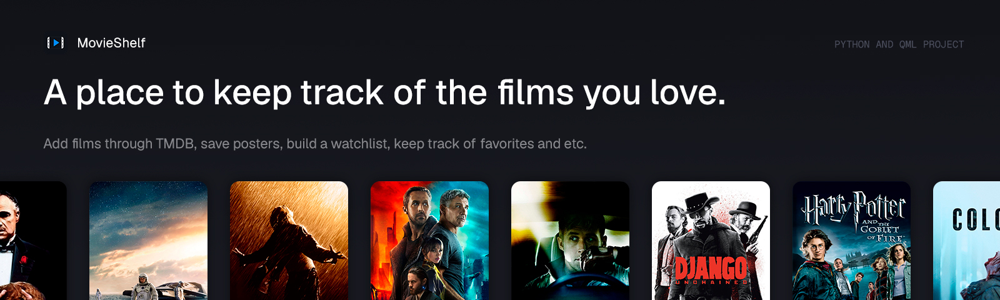

⁠⁠


# MovieShelf

MovieShelf is a personal home for your movies. Add films manually or find them through TMDB, save posters, build a watchlist, and keep track of favorites. Write reviews, rate each film, and record every viewing, including rewatches. Organize your library with genres, tags, custom collections, and filters. Explore your viewing habits through statistics, and make the app your own with themes, fonts, and keyboard shortcuts. MovieShelf is available in English, Russian, and Kazakh.

| Project | Description |
| --- | --- |
| [Desktop](desktop/README.md) | Python + PySide6 + Qt Quick/QML, light and dark themes, adjustable posters, reviews, ratings and collections. |
| [Console](console/README.md) | The original command-line project, preserved with its own data. |

## Launch the desktop app

```powershell
.\.venv\Scripts\python.exe -m pip install -r desktop/requirements.txt
.\.venv\Scripts\python.exe desktop/main.py
```

If `.venv` does not exist yet, create it with `python -m venv .venv`.

Your desktop collection uses `desktop/movies.json`, `desktop/posters/`, `desktop/movie_id_counter.json`, and `desktop/collections.json` if you create custom collections. Keep them together when moving the app. The desktop and console versions have separate collections.

The current 2.0.0 source launches the QML interface. Existing 1.3.0 release executables retain their original version and interface. The PySide2 legacy version has not been changed.

See [the desktop guide](desktop/README.md) for features and build instructions, or [the QML architecture notes](desktop/QML_MIGRATION.md) for an explanation of the code.
