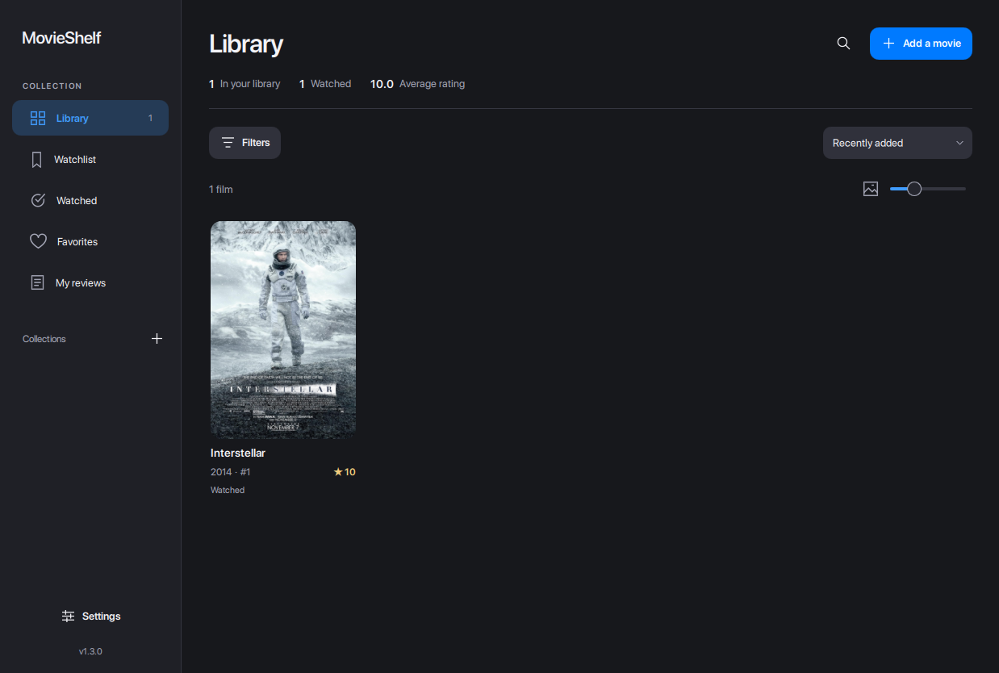

# MovieShelf Desktop

A personal movie library and review journal built with Python, PySide6 and Qt Quick/QML. The interface uses a quiet sidebar, a poster gallery, compact statistics, light and dark themes, and smooth transitions.



## Run

From the repository root on Windows:

```powershell
python -m venv .venv
.\.venv\Scripts\python.exe -m pip install -r desktop/requirements.txt
.\.venv\Scripts\python.exe desktop/main.py
```

## Your collection

- **Library:** all films, with IDs and ratings on the cards.
- **Watchlist:** films you want to watch.
- **Watched:** completed films.
- **Favorites:** personal favorites.
- **My reviews:** films with a rating or written review.
- Record viewing dates in the editor's **Viewing history** tab. Add multiple dates, including the same date more than once for repeat watches, and remove individual entries. The movie details show the full history.
- Open **Collection insights** from the sidebar to see the last 12 months of dated views and rewatches, a 1–10 rating distribution, and summary totals. Switch between the entire library and any custom collection. These figures come from local MovieShelf data and do not require TMDB.
- Create and rename custom collections, then add any film to several collections.
- Add genres and tags in the editor's Organization tab. Separate names with commas.
- Search titles, IDs, release years, descriptions, reviews, genres and tags.
- Sort by title, rating, year or most recently added ID.
- Use Filters to combine year and rating ranges, watch status, favorites, genre, tag and custom collection.
- Change the poster card size with the library slider.
- Drop a local image onto the poster editor, adjust its crop, and preview it at three card sizes before saving.
- Use **Add movie** to search TMDB by title, select a match, review its imported details and save it. You can still add a movie manually with `Ctrl+N` or **Enter manually**.
- Change the interface language in Settings: English, Russian or Kazakh. The choice is saved for the next launch.
- Click a poster to open its details, then choose **Edit movie**. **Save** applies changes without leaving the editor; **Save & view** opens the saved movie.
- The editor checks for unsaved changes when closing it or the application.
- Search opens from the magnifying glass or `Ctrl+F`; press Enter to show matching films in Library.
- Font selection uses an installed SF Pro font when available, then Segoe UI Variable, Segoe UI or Noto Sans. No Apple fonts are bundled.

## Files and data

`main.py` starts the QML application. `qml/` contains the screens and reusable visual components. `qml_backend.py` connects those screens to filtering, editing, settings, TMDB and backups. `tmdb_service.py` handles TMDB requests and the personal credential. `movie_store.py` continues to manage collection files, IDs and posters. `i18n.py` and `preferences.py` provide translations and preferences.

## TMDB setup

1. Create your own TMDB account and request an API key at [the TMDB API settings page](https://www.themoviedb.org/settings/api).
2. Open **Add movie** or **Settings** and enter your own v3 API key or API Read Access Token. Each operating-system user has a separate credential; MovieShelf does not ship with a shared key.
3. Search for a title, select the result and check the draft before saving. The title, year, overview, genres and available poster are imported. Your rating, review, watch status, tags and collections remain your own.

The credential is stored in your operating system's Qt application configuration directory as `tmdb.json`, outside the library. It is excluded from MovieShelf library backups. It is stored locally as plain text, so protect your user account and do not share the file. **Remove key** in Settings deletes it. A missing poster or unavailable network does not prevent manual entry.

TMDB states that API use is free for noncommercial projects with attribution; commercial use requires separate licensing. Supplying a personal key does not change those terms. See the [TMDB FAQ](https://developer.themoviedb.org/docs/faq). This product uses the TMDB API but is not endorsed or certified by TMDB.

The previous PySide6 Widgets interface is available with `python desktop/widgets_main.py` from the repository root. Its helper modules (`editor.py`, `panels.py`, `posters.py`, `theme.py`, `motion.py`) are retained for that entry point. Both modern interfaces use the same library files. The separate `legacy-win32/` project is unchanged.

See [QML_MIGRATION.md](QML_MIGRATION.md) for a walkthrough of the architecture.

Your collection uses `movies.json`, `posters/`, `movie_id_counter.json`, and `collections.json` after you create a custom collection. Keep these files when moving your library. Settings → Export library backup includes the collection registry. `movies.json.lock` is created automatically to coordinate simultaneous app sessions.

## Shortcuts

- `Ctrl+N`: add a film.
- `Ctrl+F`: open search.
- `Ctrl+S`: save the movie editor.
- `Esc`: close a dialog, or request to close the editor.
